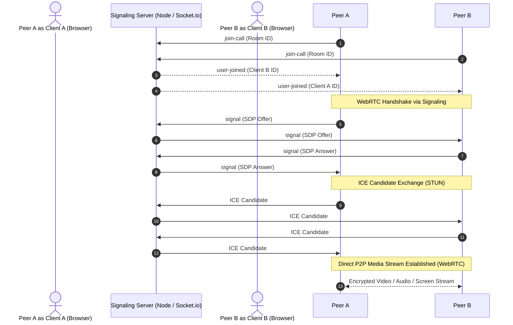

# PulseMeet - Real-Time Video Conferencing Platform

PulseMeet is a high-performance, browser-native video conferencing application built with the **MERN stack**, **WebRTC**, and **Socket.io**. It enables multi-peer video and audio calling, dynamic screen sharing, and real-time text chat with sub-second latency.

---

## 🌟 Key Features

- **Peer-to-Peer Video & Audio:** Direct browser-to-browser media streaming with low latency via WebRTC.
- **Dynamic Screen Sharing:** Instant screen and tab sharing utilizing the browser `MediaDevices.getDisplayMedia` API.
- **Real-Time Signaling:** Robust WebSocket signaling server powered by Socket.io for SDP offer/answer exchange and ICE candidate negotiation.
- **In-Meeting Real-Time Chat:** Low-latency messaging during calls with unread message notification badges.
- **Secure Authentication:** User registration, secure password hashing with Bcrypt, and token-based session management.
- **Meeting Activity & History:** Automatic tracking of past meetings and quick re-join capabilities.

---

## 🏗️ Architecture & Signaling Flow



---

## 🛠️ Tech Stack

- **Frontend:** React 18, Material-UI (MUI), Socket.io-client, WebRTC API
- **Backend:** Node.js, Express.js, Socket.io, Mongoose (MongoDB)
- **Security & Data:** Bcrypt, MongoDB Atlas
- **Network Protocol:** STUN (Google STUN servers), WebSockets (WSS), WebRTC (SRTP/DTLS)

---

## 🚀 Getting Started

### Prerequisites
- Node.js (v18 or higher recommended)
- MongoDB instance (Local or MongoDB Atlas)

### 1. Clone the repository
```bash
git clone https://github.com/yourusername/pulse-meet.git
cd pulse-meet
```

### 2. Backend Setup
```bash
cd backend
npm install
```

Create a `.env` file in the `backend/` directory:
```env
PORT=8000
MONGODB_URI=your_mongodb_connection_string
```

Start the backend development server:
```bash
npm run dev
```

### 3. Frontend Setup
```bash
cd ../frontend
npm install
```

Create a `.env` file in the `frontend/` directory (optional for local dev):
```env
REACT_APP_BACKEND_URL=http://localhost:8000
```

Start the React development server:
```bash
npm start
```

The application will be running at `http://localhost:3000`.

---

## 📂 Project Structure

```
pulse-meet/
├── backend/
│   ├── src/
│   │   ├── controllers/       # Socket manager & user controllers
│   │   ├── models/            # Mongoose schemas (User, Meeting)
│   │   ├── routes/            # Express REST API routes
│   │   └── app.js             # Server entry point & DB connection
│   └── package.json
│
├── frontend/
│   ├── src/
│   │   ├── contexts/          # Auth & state management
│   │   ├── pages/             # Landing, Auth, Home, History & VideoMeet
│   │   ├── styles/            # CSS module stylesheets
│   │   ├── utils/             # Route guards (withAuth)
│   │   ├── App.js             # Client routing
│   │   └── environment.js     # Environment-driven API endpoints
│   └── package.json
│
└── README.md
```

---

## 📄 License
Distributed under the MIT License. See `LICENSE` for more information.
